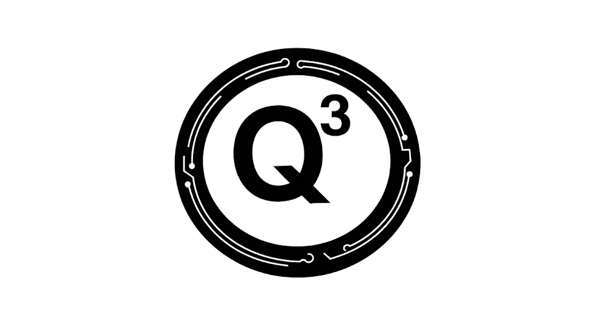
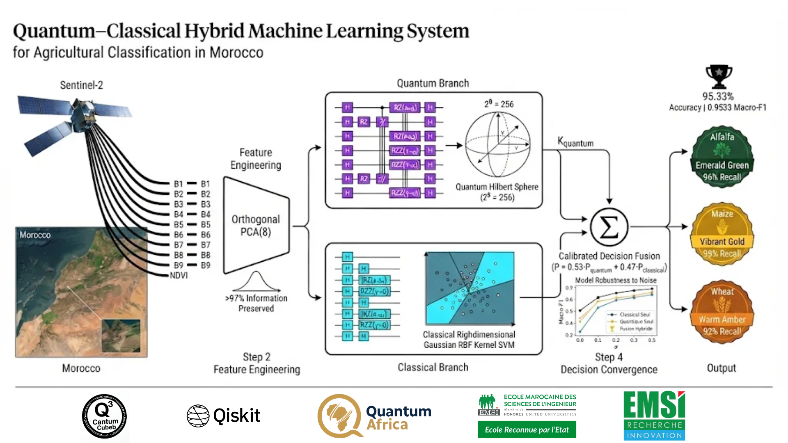
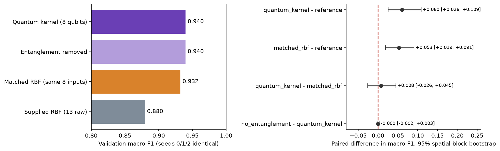
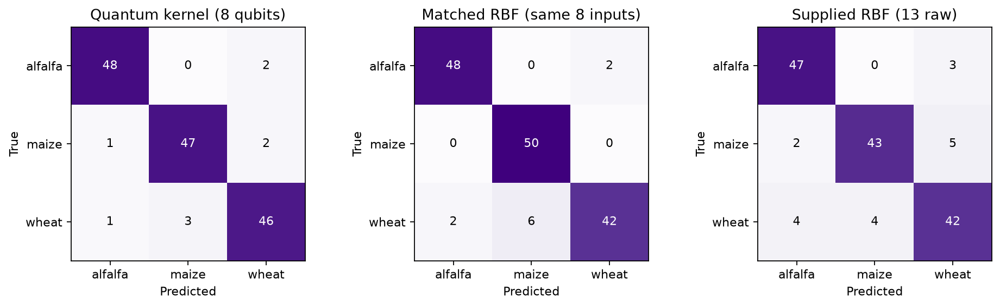
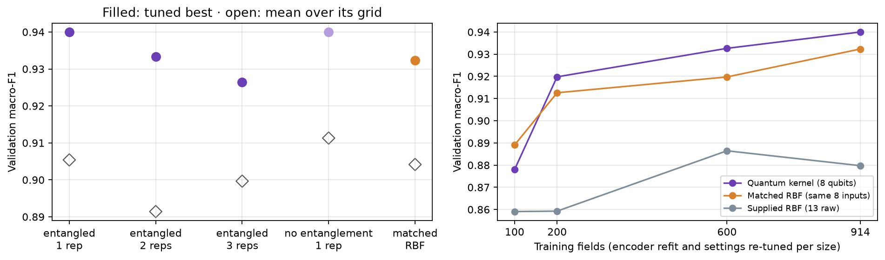
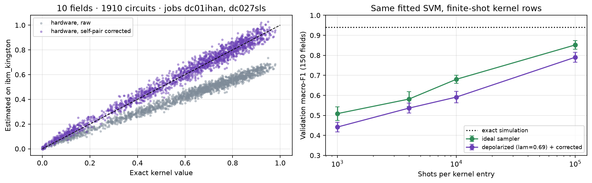
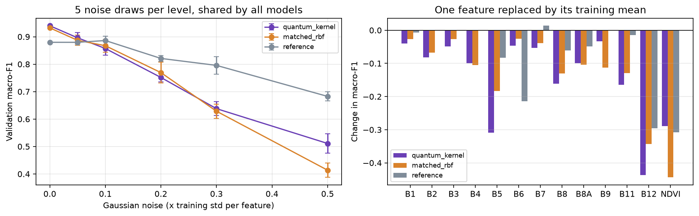

<p align="center">
  
  &nbsp;&nbsp;&nbsp;&nbsp;
  
  &nbsp;&nbsp;&nbsp;&nbsp;
  
</p>

<p align="center"><a href="README.md">English</a> · <b>Français</b></p>

# Moroccan Crop Classification Challenge
### Qiskit Fall Fest · EMSI · Quantum Africa — Équipe **Q³ (Quantum Cube)**

[](https://www.python.org/downloads/)
[](https://www.ibm.com/quantum/qiskit)
[](#4-matériel-quantique-ibm)
[](#benchmark-des-architectures)
[](challenge/submission.py)

---

## Résumé

Ce dépôt contient notre solution complète et reproductible au **Moroccan Crop Classification Challenge** (EMSI · Quantum Africa · Qiskit Fall Fest). La tâche : classer des parcelles de **luzerne, maïs et blé** de la région de Doukkala à partir de 13 variables Sentinel-2, avec **914 parcelles d'entraînement, 150 de validation et 221 de test sans étiquettes**.

Partant du QNN à 4 qubits fourni, moins bon que la référence classique (0,856 contre 0,880 de macro-F1), nous avons mené une étude systématique :

1. **Représentation.** Sélectionner des bandes physiques fait chuter le score à 0,840 (les bandes Sentinel-2 sont fortement corrélées), alors qu'une projection orthogonale **PCA(8)** conserve plus de 97 % de la variance et atteint 0,940 — une composante par qubit.
2. **Noyau quantique à 8 qubits.** Un noyau quantique de fidélité (QSVM) atteint **0,9400 de macro-F1**. Sans intrication (γ = 0), le score est identique : c'est la représentation, et non l'intrication, qui fait le résultat.
3. **Le biais sur le blé.** Le noyau quantique et le RBF classique aligné sont à égalité globale, mais le RBF rate le blé (**rappel 84 %**, surtout confondu avec le maïs) tandis que le noyau quantique atteint **92 %**. C'est le seul écart qui résiste à un bootstrap apparié par blocs spatiaux (+8 pts, IC 95 % [+1,6 ; +20]).
4. **Fusion décisionnelle hybride.** Nous mélangeons les décisions des deux modèles (**53 % noyau quantique + 47 % RBF**, α = 0,53, d'après Grossi et al., 2022) : **macro-F1 de 0,9533** en validation (143/150 parcelles), avec au moins 92 % de rappel sur chaque culture.
5. **Matériel quantique IBM.** La branche quantique a tourné sur **`ibm_kingston`, processeur Heron r2 de 156 qubits** (jobs `dc01ihanj2vs73dda82g`, `dc027sls2omc7388l0q0`, `dc0onjinj2vs73deb200`). Sur les 12 parcelles évaluées, la fusion soumise complète en classe 9 correctement contre 5 pour le noyau quantique seul, mais ne bat jamais le RBF classique : le bruit du matériel actuel efface le gain.
6. **Audit de la validation.** Les hyperparamètres et α ont été choisis sur les mêmes 150 parcelles de validation ; nous avons donc audité le résultat ([`challenge/validation_audit.py`](challenge/validation_audit.py)) : 0,9533 est optimiste, la fusion ne bat le noyau quantique seul que d'**une parcelle**, et un **jumeau classique** du noyau (forme fermée ∏cos², sans circuit) obtient presque le même score. Nous le présentons comme un résultat négatif clair sur l'avantage quantique.

<p align="center">
  
</p>

---

## Benchmark des architectures

Nous avons implémenté et comparé les cinq familles d'architectures proposées dans le sujet (`docs/HINTS.md`). Tous les scores portent sur les 150 parcelles de validation.

| # | Architecture | Variables | Qubits | Taille | Macro-F1 | Accuracy | Rappel blé | Entraînement |
|---|---|---|:---:|:---:|:---:|:---:|:---:|:---:|
| 1 | QNN variationnel *(Pérez-Salinas et al., 2020)* † | 4 PCA | 4 | 8 angles | 0,8062 | 80,67 % | 90 % | 59,5 s |
| 2 | Quantum Kitchen Sinks *(Wilson et al., 2018)* | 13 brutes | 4 | 183 param. | 0,8266 | 82,67 % | 82 % | 0,05 s |
| 3 | RBF-SVM classique aligné | 8 PCA | 0 | 233 VS | 0,9323 | 93,33 % | 84 % | 0,07 s |
| 4 | Noyau quantique 8 qubits *(Havlíček et al., 2019)* | 8 PCA | 8 | 190 VS | 0,9400 | 94,00 % | 92 % | 2,7 s |
| 5 | **Fusion décisionnelle calibrée** *(Grossi et al., 2022)* | **8 PCA** | **8** | 2 SVM + α | **0,9533** | **95,33 %** | **92 %** | 1,9 s |

† Version du benchmark entraînée sur 200 parcelles. Le QNN fourni, entraîné sur les 914 parcelles, obtient 0,8557 ± 0,006 (3 seeds). VS = vecteurs de support.

> **Modèle soumis :** ligne 5 ([`challenge/submission.py`](challenge/submission.py)). Il est déterministe (résultats identiques pour les seeds 0, 1 et 2) et s'entraîne et prédit en environ 2 secondes, bien en dessous du budget de 35 minutes.

### Choix du poids de fusion α

Balayage de 101 valeurs de α ∈ [0 ; 1] sur la validation :

| α | Parcelles correctes | Macro-F1 | Remarque |
|---|:---:|:---:|---|
| 0,00 (RBF seul) | 140/150 | 0,9323 | rappel blé 84 % |
| 0,50 | 142/150 | 0,9465 | |
| **0,52 – 0,54** | **143/150** | **0,9533** | maïs 98 %, blé 92 % |
| 0,55 – 1,00 (dont noyau quantique seul) | 142/150 | 0,9467 | |

Avec `svm.predict` (votes un-contre-un), le noyau quantique seul obtient 141/150 : la parcelle 56 est une égalité parfaite à trois votes, attribuée à la mauvaise classe. Avec la même règle que la fusion (marge maximale), il obtient 142/150 : **la fusion gagne donc une parcelle**, sur une fenêtre étroite de α. Reproduire avec `python -m challenge.fusion`.

---

## Résultats

### 1. Scores et contrôles alignés
<p align="center"></p>

Le noyau quantique à 8 qubits dépasse la référence fournie (+0,060 de macro-F1) et égale le contrôle RBF entraîné sur les mêmes composantes.

### 2. Biais sur le blé et matrices de confusion
<p align="center"></p>

- **Les modèles classiques ratent le blé (rappel 84 %).** Référence fournie (13 bandes brutes) : ligne blé `[4, 4, 42]`. RBF aligné (8 PCA) : `[2, 6, 42]`, soit 6 blés prédits maïs.
- **Noyau quantique :** ligne blé `[1, 3, 46]`, rappel 92 %.
- **Fusion (α = 0,53) :** luzerne 96 %, maïs 98 %, blé 92 %, soit 143/150 parcelles.

### 3. Ablation de l'intrication et profondeur du circuit
<p align="center"></p>

- Sans portes RZZ (γ = 0), le noyau est égal à la forme fermée classique ∏cos²(a·Δx) à 4,8 × 10⁻¹⁵ près, avec le même macro-F1 de 0,940.
- Répéter le bloc du circuit fait baisser le score (reps 1 → 2 → 3 : 0,940 → 0,933 → 0,926).

### 4. Matériel quantique IBM
<p align="center"></p>

- **Backend :** `ibm_kingston`, IBM Heron r2, 156 qubits. Jobs `dc01ihanj2vs73dda82g`, `dc027sls2omc7388l0q0`, `dc0onjinj2vs73deb200` (441 s de QPU).
- **Protocole :** 2 292 circuits compute-uncompute pour 12 parcelles de validation fixées (une ligne de noyau sur les 190 vecteurs de support, plus un circuit auto-apparié par parcelle), 1 000 ou 500 shots, Pauli twirling, dynamical decoupling et correction globale par le facteur de contraction λ ≈ 0,66–0,75. Les SVM sont entraînés localement ; seule l'inférence passe sur le QPU.

**La fusion soumise sur matériel.** Le noyau quantique est la seule partie du modèle soumis qui peut tourner sur un QPU : nous avons donc rejoué la fusion complète avec des marges quantiques calculées à partir des lignes de noyau mesurées. La branche RBF reste classique.

| 12 parcelles de validation | Simulation exacte | Échantillonneur idéal (mêmes shots) | **`ibm_kingston` (corrigé λ)** |
|---|:---:|:---:|:---:|
| Noyau quantique seul | 11/12 | 9/12 | 5/12 |
| **Fusion soumise (α = 0,53)** | 11/12 | 10/12 | **9/12** |
| RBF seul (CPU, référence) | 11/12 | — | — |

- La fusion récupère 3 des 5 erreurs du noyau quantique sur matériel, car la branche RBF exacte compense les marges bruitées, mais elle ne bat jamais le RBF seul.
- Les parcelles 35 et 38 font partie des cinq parcelles de validation où la fusion et le RBF divergent en simulation exacte ; elles ont été fixées avant le job. Sur matériel, la correction quantique de la parcelle 35 est perdue.
- **Bruit d'échantillonnage :** dans une étude simulée sur les 150 parcelles (`outputs/qk/hardware/shots_study.json`), le macro-F1 du noyau tombe à ≈ 0,51 à 1 000 shots par valeur et reste à 0,85 (idéal) ou 0,79 (bruit dépolarisant, λ = 0,69) à 100 000 shots, contre 0,94 en exact.
- Portée : 12 parcelles fixées, soit un test de faisabilité et non une estimation de précision. Reproductible sans QPU : `python -m challenge.qk_hardware fusion`.

### 5. Robustesse aux perturbations
<p align="center"></p>

Bruit gaussien de σ × l'écart-type d'entraînement de chaque bande, 5 tirages par niveau, **plan apparié** (tous les modèles voient les mêmes copies bruitées). Les modèles sont entraînés sur des données propres.

| σ | RBF aligné (α = 0) | Noyau quantique (α = 1) | Fusion (α = 0,53) |
|:---:|:---:|:---:|:---:|
| 0,00 | 0,9323 | 0,9467 | **0,9533** |
| 0,05 | 0,8882 | 0,8975 | 0,8974 |
| 0,10 | 0,8687 | 0,8599 | 0,8638 |
| 0,20 | 0,7619 | 0,7639 | 0,7648 |
| 0,30 | 0,6381 | 0,6639 | 0,6609 |
| 0,50 | 0,4242 | **0,5261** | 0,4860 |

Jusqu'à σ = 0,3, les trois modèles restent à ± 0,03 les uns des autres. À σ = 0,5, le noyau quantique seul se dégrade le moins. Il s'agit d'un test de sensibilité synthétique, pas d'une simulation de panne de capteur ; le biais systématique de capteur n'a pas été testé.

### 6. Benchmark des circuits quantiques

Mêmes entrées PCA-8, même SVM et même règle de fusion : seul le circuit change ([`challenge/circuits.py`](challenge/circuits.py), `outputs/circuit_benchmark.json`).

| Piste | Circuit | Macro-F1 noyau | Macro-F1 fusion | Fusion correctes | Rappel blé |
|---|---|:---:|:---:|:---:|:---:|
| Référence | **Chaîne linéaire (a = 0,2, γ = 0,01, reps = 1)** | **0,9400** | **0,9533** | **143/150** | **92 %** |
| A · Feature map | `ZZFeatureMap` Qiskit (linéaire) | 0,3161 | 0,6283 | 96/150 | 96 % |
| A · Feature map | RY·RX + RZZ personnalisé | 0,9127 | 0,9056 | 136/150 | 82 % |
| B · Re-uploading | 2 couches d'encodage + mélange RY(π/4) | 0,9327 | 0,9327 | 140/150 | 86 % |
| C · Topologie | Anneau (8 RZZ) | 0,9400 | 0,9533 | 143/150 | 92 % |
| C · Topologie | Tous-à-tous (28 RZZ) | 0,9400 | 0,9465 | 142/150 | 90 % |
| C · Topologie | Sans intrication (γ = 0) | 0,9400 | 0,9465 | 142/150 | 90 % |
| D · Largeur de bande | a = 0,05 | 0,9056 | 0,9121 | 137/150 | 82 % |
| D · Largeur de bande | a = 0,40 | 0,9192 | 0,9192 | 138/150 | 84 % |

Le facteur d'échelle des angles *a* est le choix décisif ; la topologie d'intrication et la profondeur n'améliorent pas le noyau.

### 7. Audit de la validation : optimisme, incertitude et part quantique

Exécution : `python -m challenge.validation_audit` (~1 min, `outputs/audit/validation_audit.json`).

**Q1 — Et si la validation ne servait jamais à choisir ?** Tous les choix sont refaits par validation croisée stratifiée à 5 plis sur les 914 parcelles d'entraînement uniquement, puis la validation est évaluée une seule fois.

| Modèle | Réglé sur la validation (rapporté) | Réglé par CV sur l'entraînement |
|---|:---:|:---:|
| Noyau quantique 8 qubits | 0,9467 (142/150) | 0,8930 (134/150) |
| RBF aligné | 0,9323 (140/150) | 0,9057 (136/150) |
| Jumeau classique ∏cos² | 0,9400 (141/150) | 0,9197 (138/150) |
| **Fusion QK + RBF** | **0,9533 (143/150)** | 0,8998 (135/150) |

Tous les modèles perdent 0,03 à 0,05 et le classement change : il faut s'attendre à un score de test inférieur à 0,9533.

**Q2 — Les écarts dépassent-ils le hasard ?** Bootstrap apparié sur les 18 blocs spatiaux de la validation (4 000 rééchantillonnages, intervalles à 95 %).

| Comparaison (B − A) | Parcelles différentes | Δ macro-F1 [IC 95 %] | Δ rappel blé [IC 95 %] |
|---|:---:|:---:|:---:|
| Fusion − noyau quantique | 1 | +0,007 [0,000 ; +0,028] | 0 |
| Fusion − RBF aligné | 5 | +0,021 [−0,008 ; +0,064] | **+0,08 [+0,016 ; +0,20]** |
| Noyau quantique − RBF aligné | 6 | +0,014 [−0,021 ; +0,057] | **+0,08 [+0,016 ; +0,20]** |

Aucune différence de macro-F1 n'est établie ; le gain sur le rappel du blé l'est.

**Q3 — Le gain est-il quantique ?** Avec γ = 0,01, le noyau est presque égal à sa forme sans intrication ∏cos²(a·Δx), calculable directement sur un ordinateur portable. Fusionné avec le même RBF, ce jumeau classique obtient 142/150 contre 143/150 pour la fusion soumise, soit une parcelle d'écart. Le gain vient de la combinaison de deux formes de noyau différentes ; **l'intrication n'apporte aucun bénéfice mesurable sur ces données, et nous ne revendiquons pas d'avantage quantique.**

---

## Explorateur interactif des résultats — Quantum Cube CropLab

Une application Streamlit présente toutes les expériences, les deux benchmarks, les tests de robustesse et l'exécution sur matériel IBM. Elle lit uniquement les résultats sauvegardés : elle ne ré-entraîne aucun modèle et n'exécute aucun circuit.

```bash
pip install -r dashboard/requirements.txt
streamlit run dashboard/app.py
```

---

## Organisation du dépôt

```
├── challenge/
│   ├── submission.py         # Modèle soumis : fusion décisionnelle calibrée (α = 0,53)
│   ├── qkernel.py            # Noyau quantique 8 qubits et contrôle RBF aligné
│   ├── fusion.py             # Balayage de α et tests de robustesse
│   ├── validation_audit.py   # Sélection sur l'entraînement, bootstrap spatial, jumeau classique
│   ├── circuits.py           # Benchmark des circuits quantiques
│   ├── qk_run.py             # Grilles de réglage, seeds, ablations, courbe d'apprentissage
│   ├── qk_hardware.py        # Matériel IBM : submit / analyze / fusion sur noyaux mesurés
│   ├── qk_reliability.py     # Robustesse au bruit et à la perte de bandes
│   ├── qk_figures.py         # Figures 1 à 5
│   ├── models.py             # QNN de départ et contrôle MLP aligné
│   ├── classical.py, coverage.py, data.py, metrics.py   # Fournis par les organisateurs
├── dashboard/                # Application Streamlit (Quantum Cube CropLab)
├── notebooks/                # Notebook principal, étude de fusion, benchmark des alternatives
├── outputs/                  # Résultats sauvegardés, figures et rapports du matériel IBM
├── configs/                  # Hyperparamètres finaux
└── QuantumCube_Presentation.pptx
```

---

## Installation et reproduction

```bash
git clone https://github.com/riyadh03/QiskitFallFest_EMSI_QuantumAfrica.git
cd QiskitFallFest_EMSI_QuantumAfrica
python -m venv .venv
.\.venv\Scripts\Activate.ps1      # Windows PowerShell
# source .venv/bin/activate       # Linux / macOS
pip install -r requirements.txt

python -m challenge.coverage check   # intégrité des données : train 914, validation 150, test 221
```

Exécuter le modèle soumis :

```python
from challenge.submission import Submission
model = Submission().fit(X_train, y_train)
predictions = model.predict(X_test)
```

Le notebook principal est [`notebooks/Qiskit_QuantumAfrica_Crop_Challenge.ipynb`](notebooks/Qiskit_QuantumAfrica_Crop_Challenge.ipynb).

---

## Équipe Q³ (Quantum Cube)

| Membre | Contact |
|---|---|
| **AYOGNIDE Riyadh Akorede Atanda** | [](mailto:riyadhscaler@gmail.com) [](https://github.com/riyadh03) |
| **Adib ZINDINE** | [](mailto:adibzindine@outlook.com) [](https://www.linkedin.com/in/adib-zindine) [](https://github.com/lilrawry) |
| **Aymane KILALI** | [](mailto:Aymanekilali@gmail.com) [](https://www.linkedin.com/in/aymane-kilali-37053525a/) [](https://github.com/Aymane-k) |

---

## Données et citations

Le jeu de données est adapté de Ouassanouan et al., [Moroccan Crop and Irrigation Dataset v2](https://doi.org/10.6084/m9.figshare.28486022.v2), sous licence [CC BY 4.0](https://creativecommons.org/licenses/by/4.0/).

```bibtex
@article{ouassanouan2026crop,
  title={Crop and irrigation types ground-truth dataset for Moroccan agricultural regions},
  author={Ouassanouan, Y. and Elfarkh, J. and Grich, S. and Liblab, A. and Chehbouni, A.},
  journal={Scientific Data}, volume={13}, pages={746}, year={2026},
  publisher={Nature Publishing Group}
}
@article{grossi2022mixed,
  title={Mixed quantum-classical ensemble for anomaly detection and classification},
  author={Grossi, M. and others}, journal={arXiv preprint arXiv:2208.07963}, year={2022}
}
@article{havlicek2019supervised,
  title={Supervised learning with quantum-enhanced feature spaces},
  author={Havl{\'\i}{\v{c}}ek, V. and others}, journal={Nature}, volume={567}, pages={209--212}, year={2019}
}
```

---
*Projet réalisé pour le Qiskit Fall Fest · EMSI · Quantum Africa 2026.*
