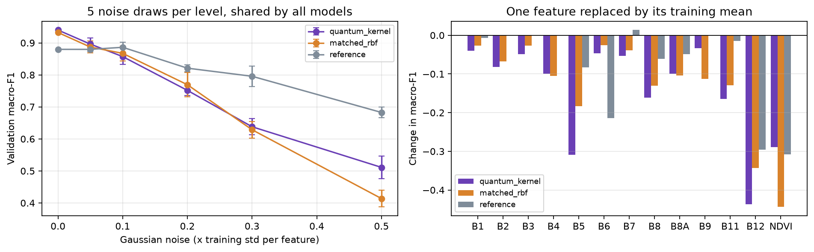

<p align="center">
  
  &nbsp;&nbsp;&nbsp;&nbsp;
  
  &nbsp;&nbsp;&nbsp;&nbsp;
  
</p>

<p align="center"><b>English</b> · <a href="README.fr.md">Français</a></p>

# Moroccan Crop Classification Challenge
### Qiskit Fall Fest · EMSI · Quantum Africa — Team **Q³ · Quantum Cubeb**

[](https://q3-croplab.streamlit.app/)
[](https://www.python.org/downloads/)
[](https://www.ibm.com/quantum/qiskit)
[](#4-ibm-quantum-hardware)
[](#architecture-benchmark)
[](challenge/submission.py)

---

## Executive summary

This repository contains our complete, reproducible solution to the **Moroccan Crop Classification Challenge** (EMSI · Quantum Africa · Qiskit Fall Fest). The task is to classify **alfalfa, maize and wheat** fields in the Doukkala region from 13 Sentinel-2 features, with **914 training, 150 validation and 221 unlabelled test fields**.

Starting from the supplied 4-qubit QNN, which scored below the classical reference (0.856 vs 0.880 macro-F1), we ran a systematic investigation:

1. **Representation.** Selecting physical bands drops performance to 0.840 macro-F1 (Sentinel-2 bands are strongly collinear), whereas an orthogonal **PCA(8)** projection keeps over 97% of the variance and reaches 0.940 — one component per qubit.
2. **8-qubit quantum kernel.** A fidelity quantum kernel (QSVM) reaches **0.9400 macro-F1**. Removing entanglement (γ = 0) gives the same score: the representation, not entanglement, drives the result.
3. **The wheat bias.** The quantum kernel and the matched classical RBF are tied overall, but the RBF misses wheat (**recall 84%**, mostly confused with maize) while the quantum kernel reaches **92%**. This is the one difference that survives a paired spatial-block bootstrap (+8 pts, 95% CI [+1.6, +20]).
4. **Hybrid decision fusion.** We blend both models' decisions (**53% quantum kernel + 47% RBF**, α = 0.53, after Grossi et al., 2022): **macro-F1 0.9533** on validation (143/150 fields) with at least 92% recall on every crop.
5. **IBM quantum hardware.** The quantum branch ran on the **156-qubit Heron r2 `ibm_kingston`** (jobs `dc01ihanj2vs73dda82g`, `dc027sls2omc7388l0q0`, `dc0onjinj2vs73deb200`). On the 12 hardware fields, the full submitted fusion gets 9/12 right versus 5/12 for the quantum kernel alone, but never beats the classical RBF: current hardware noise erases the gain.
6. **Validation audit.** Hyper-parameters and α were chosen on the same 150 validation fields, so we audited the result ([`challenge/validation_audit.py`](challenge/validation_audit.py)): 0.9533 is optimistic, the fusion beats the quantum kernel alone by **a single field**, and a **classical twin** of the circuit kernel (closed form ∏cos², no circuit) scores almost the same. We report this as a clear negative finding on quantum advantage.

<p align="center">
  
</p>

---

## Architecture benchmark

We implemented and compared the five architectural families suggested in the challenge brief (`docs/HINTS.md`). All scores are on the 150-field validation split.

| # | Architecture | Features | Qubits | Size | Macro-F1 | Accuracy | Wheat recall | Train time |
|---|---|---|:---:|:---:|:---:|:---:|:---:|:---:|
| 1 | Variational QNN *(Pérez-Salinas et al., 2020)* † | 4 PCA | 4 | 8 angles | 0.8062 | 80.67% | 90% | 59.5 s |
| 2 | Quantum Kitchen Sinks *(Wilson et al., 2018)* | 13 raw | 4 | 183 params | 0.8266 | 82.67% | 82% | 0.05 s |
| 3 | Matched classical RBF-SVM | 8 PCA | 0 | 233 SVs | 0.9323 | 93.33% | 84% | 0.07 s |
| 4 | 8-qubit quantum kernel *(Havlíček et al., 2019)* | 8 PCA | 8 | 190 SVs | 0.9400 | 94.00% | 92% | 2.7 s |
| 5 | **Calibrated decision fusion** *(Grossi et al., 2022)* | **8 PCA** | **8** | 2 SVMs + α | **0.9533** | **95.33%** | **92%** | 1.9 s |

† Benchmark run trained on 200 training fields. The supplied starter QNN trained on all 914 fields scores 0.8557 ± 0.006 (3 seeds).

> **Submitted model:** row 5 ([`challenge/submission.py`](challenge/submission.py)). It is deterministic (identical results for seeds 0, 1 and 2) and trains and predicts in about 2 seconds, well within the 35-minute budget.

### Choosing the fusion weight α

A 101-point scan over α ∈ [0, 1] on validation:

| α | Fields correct | Macro-F1 | Note |
|---|:---:|:---:|---|
| 0.00 (RBF only) | 140/150 | 0.9323 | wheat recall 84% |
| 0.50 | 142/150 | 0.9465 | |
| **0.52 – 0.54** | **143/150** | **0.9533** | maize 98%, wheat 92% |
| 0.55 – 1.00 (incl. quantum kernel only) | 142/150 | 0.9467 | |

With `svm.predict` (one-vs-one votes) the quantum kernel alone scores 141/150: field 56 is a perfect three-way vote tie assigned to the wrong class. With the same decision rule as the fusion (largest margin) it scores 142/150, so **the fusion gains one field**, on a narrow α window. Reproduce with `python -m challenge.fusion`.

---

## Results

### 1. Scores and matched controls
<p align="center"></p>

The 8-qubit quantum kernel beats the supplied reference (+0.060 macro-F1) and matches the RBF control trained on the same components.

### 2. Wheat bias and confusion matrices
<p align="center"></p>

- **Classical models miss wheat (84% recall).** Supplied reference (13 raw bands): wheat row `[4, 4, 42]`. Matched RBF (8 PCA): `[2, 6, 42]` — 6 wheat fields predicted as maize.
- **Quantum kernel:** wheat row `[1, 3, 46]`, 92% recall.
- **Fusion (α = 0.53):** 96% alfalfa, 98% maize, 92% wheat — 143/150 fields.

### 3. Entanglement ablation and circuit depth
<p align="center"></p>

- Without RZZ gates (γ = 0) the kernel equals the classical closed form ∏cos²(a·Δx) to 4.8 × 10⁻¹⁵, with the same 0.940 macro-F1.
- Repeating the circuit block lowers the score (reps 1 → 2 → 3: 0.940 → 0.933 → 0.926).

### 4. IBM quantum hardware
<p align="center"></p>

- **Backend:** `ibm_kingston`, IBM Heron r2, 156 qubits. Jobs `dc01ihanj2vs73dda82g`, `dc027sls2omc7388l0q0`, `dc0onjinj2vs73deb200` (441 s of QPU time).
- **Protocol:** 2,292 compute-uncompute circuits for 12 fixed validation fields (one kernel row over the 190 support vectors plus one self-pair circuit per field), 1,000 or 500 shots, Pauli twirling, dynamical decoupling, and a global correction by the self-pair shrink factor λ ≈ 0.66–0.75. The SVMs are trained locally; only inference runs on the QPU.

**The submitted fusion on hardware.** The quantum kernel is the only part of the submitted model that can run on a QPU, so we replayed the full fusion with the quantum margins computed from hardware-measured kernel rows. The RBF branch stays classical.

| 12 validation fields | Exact simulation | Ideal sampler (same shots) | **`ibm_kingston` (λ-corrected)** |
|---|:---:|:---:|:---:|
| Quantum kernel alone | 11/12 | 9/12 | 5/12 |
| **Submitted fusion (α = 0.53)** | 11/12 | 10/12 | **9/12** |
| RBF alone (CPU, reference) | 11/12 | — | — |

- The fusion recovers 3 of the quantum kernel's 5 hardware errors, because the exact RBF branch compensates for noisy margins — but it never beats the RBF alone.
- Fields 35 and 38 are two of the five validation fields where the fusion and the RBF disagree in exact simulation; they were fixed before the job. On hardware, the quantum correction on field 35 is lost.
- **Shot noise:** in a simulated study on all 150 fields (`outputs/qk/hardware/shots_study.json`), kernel macro-F1 drops to ≈ 0.51 at 1,000 shots per entry and is still 0.85 (ideal) or 0.79 (depolarizing noise, λ = 0.69) at 100,000 shots, versus 0.94 exactly.
- Scope: 12 fixed fields — a feasibility check, not an accuracy estimate. Reproduce without the QPU: `python -m challenge.qk_hardware fusion`.

### 5. Robustness to perturbations
<p align="center"></p>

Gaussian noise of σ × the training standard deviation of each band, 5 draws per level, **paired design** (all models see the same noisy copies). Models are trained on clean data.

| σ | Matched RBF (α = 0) | Quantum kernel (α = 1) | Fusion (α = 0.53) |
|:---:|:---:|:---:|:---:|
| 0.00 | 0.9323 | 0.9467 | **0.9533** |
| 0.05 | 0.8882 | 0.8975 | 0.8974 |
| 0.10 | 0.8687 | 0.8599 | 0.8638 |
| 0.20 | 0.7619 | 0.7639 | 0.7648 |
| 0.30 | 0.6381 | 0.6639 | 0.6609 |
| 0.50 | 0.4242 | **0.5261** | 0.4860 |

Up to σ = 0.3 the three models stay within ± 0.03 of each other. At σ = 0.5 the quantum kernel alone degrades least. This is a synthetic stress test, not a simulation of a real sensor fault; systematic sensor bias was not tested.

### 6. Quantum circuit benchmark

Same PCA-8 inputs, SVM and fusion rule — only the feature-map circuit changes ([`challenge/circuits.py`](challenge/circuits.py), `outputs/circuit_benchmark.json`).

| Track | Circuit | Kernel macro-F1 | Fusion macro-F1 | Fusion correct | Wheat recall |
|---|---|:---:|:---:|:---:|:---:|
| Reference | **Linear chain (a = 0.2, γ = 0.01, reps = 1)** | **0.9400** | **0.9533** | **143/150** | **92%** |
| A · Feature map | Qiskit `ZZFeatureMap` (linear) | 0.3161 | 0.6283 | 96/150 | 96% |
| A · Feature map | Custom RY·RX + RZZ | 0.9127 | 0.9056 | 136/150 | 82% |
| B · Re-uploading | 2 encoding layers + RY(π/4) mixing | 0.9327 | 0.9327 | 140/150 | 86% |
| C · Topology | Ring (8 RZZ) | 0.9400 | 0.9533 | 143/150 | 92% |
| C · Topology | All-to-all (28 RZZ) | 0.9400 | 0.9465 | 142/150 | 90% |
| C · Topology | No entanglement (γ = 0) | 0.9400 | 0.9465 | 142/150 | 90% |
| D · Bandwidth | a = 0.05 | 0.9056 | 0.9121 | 137/150 | 82% |
| D · Bandwidth | a = 0.40 | 0.9192 | 0.9192 | 138/150 | 84% |

The angle scale *a* is the decisive design choice; entanglement topology and depth do not improve the kernel.

### 7. Validation audit: optimism, uncertainty and the quantum contribution

Run with `python -m challenge.validation_audit` (~1 min, `outputs/audit/validation_audit.json`).

**Q1 — What if validation is never used for choices?** Every choice is redone by 5-fold stratified cross-validation on the 914 training fields only, then validation is scored once.

| Model | Tuned on validation (reported) | Tuned on training CV only |
|---|:---:|:---:|
| 8-qubit quantum kernel | 0.9467 (142/150) | 0.8930 (134/150) |
| Matched RBF | 0.9323 (140/150) | 0.9057 (136/150) |
| Classical twin ∏cos² | 0.9400 (141/150) | 0.9197 (138/150) |
| **Fusion QK + RBF** | **0.9533 (143/150)** | 0.8998 (135/150) |

Every model loses 0.03–0.05 and the ranking changes: expect a lower test score than 0.9533.

**Q2 — Are the differences larger than chance?** Paired bootstrap over the 18 spatial blocks of the validation set (4,000 resamples, 95% intervals).

| Comparison (B − A) | Fields differing | Δ macro-F1 [95% CI] | Δ wheat recall [95% CI] |
|---|:---:|:---:|:---:|
| Fusion − quantum kernel | 1 | +0.007 [0.000, +0.028] | 0 |
| Fusion − matched RBF | 5 | +0.021 [−0.008, +0.064] | **+0.08 [+0.016, +0.20]** |
| Quantum kernel − matched RBF | 6 | +0.014 [−0.021, +0.057] | **+0.08 [+0.016, +0.20]** |

No macro-F1 difference is established; the wheat-recall gain is.

**Q3 — Is the gain quantum?** With γ = 0.01 the kernel is almost its entanglement-free form ∏cos²(a·Δx), which a laptop computes directly. Fused with the same RBF, this classical twin reaches 142/150 versus 143/150 for the submitted fusion — one field. The gain comes from combining two different kernel shapes; **entanglement adds no measurable benefit on this data, and we do not claim quantum advantage.**

---

## Interactive results explorer — Q³ CropLab

A Streamlit application presents every experiment, both benchmarks, the robustness tests and the IBM hardware run. It only reads saved results; it never retrains a model or runs a circuit.

**Live app: [https://q3-croplab.streamlit.app/](https://q3-croplab.streamlit.app/)**

To run it locally:

```bash
pip install -r dashboard/requirements.txt
streamlit run dashboard/app.py
```

---

## Repository structure

```
├── challenge/
│   ├── submission.py         # Submitted model: calibrated decision fusion (α = 0.53)
│   ├── qkernel.py            # 8-qubit quantum kernel SVM and matched RBF control
│   ├── fusion.py             # α scan and robustness tests
│   ├── validation_audit.py   # Train-only selection, spatial bootstrap, classical twin
│   ├── circuits.py           # Quantum circuit benchmark
│   ├── qk_run.py             # Tuning grids, seeds, ablations, learning curve
│   ├── qk_hardware.py        # IBM hardware: submit / analyze / fusion on measured kernels
│   ├── qk_reliability.py     # Noise and band-drop robustness
│   ├── qk_figures.py         # Figures 1–5
│   ├── models.py             # Starter QNN and matched MLP control
│   ├── classical.py, coverage.py, data.py, metrics.py   # Supplied by the organizers
├── dashboard/                # Streamlit app (Q³ CropLab)
├── notebooks/                # Main notebook, fusion study, alternatives benchmark
├── outputs/                  # Saved results, figures and IBM hardware reports
├── configs/                  # Final hyper-parameters
└── QuantumCube_Presentation.pptx
```

---

## Installation and reproduction

```bash
git clone https://github.com/riyadh03/QiskitFallFest_EMSI_QuantumAfrica.git
cd QiskitFallFest_EMSI_QuantumAfrica
python -m venv .venv
.\.venv\Scripts\Activate.ps1      # Windows PowerShell
# source .venv/bin/activate       # Linux / macOS
pip install -r requirements.txt

python -m challenge.coverage check   # data integrity: train 914, validation 150, test 221
```

Run the submitted model:

```python
from challenge.submission import Submission
model = Submission().fit(X_train, y_train)
predictions = model.predict(X_test)
```

The main notebook is [`notebooks/Qiskit_QuantumAfrica_Crop_Challenge.ipynb`](notebooks/Qiskit_QuantumAfrica_Crop_Challenge.ipynb).

---

## Team Q³ · Quantum Cubeb

| Member | Contact |
|---|---|
| **AYOGNIDE Riyadh Akorede Atanda** | [](mailto:riyadhscaler@gmail.com) [](https://github.com/riyadh03) |
| **Adib ZINDINE** | [](mailto:adibzindine@outlook.com) [](https://www.linkedin.com/in/adib-zindine) [](https://github.com/lilrawry) |
| **Aymane KILALI** | [](mailto:Aymanekilali@gmail.com) [](https://www.linkedin.com/in/aymane-kilali-37053525a/) [](https://github.com/Aymane-k) |

---

## Data and citations

The dataset is adapted from Ouassanouan et al., [Moroccan Crop and Irrigation Dataset v2](https://doi.org/10.6084/m9.figshare.28486022.v2), licensed under [CC BY 4.0](https://creativecommons.org/licenses/by/4.0/).

```bibtex
@article{ouassanouan2026crop,
  title={Crop and irrigation types ground-truth dataset for Moroccan agricultural regions},
  author={Ouassanouan, Y. and Elfarkh, J. and Grich, S. and Liblab, A. and Chehbouni, A.},
  journal={Scientific Data}, volume={13}, pages={746}, year={2026},
  publisher={Nature Publishing Group}
}
@article{grossi2022mixed,
  title={Mixed quantum-classical ensemble for anomaly detection and classification},
  author={Grossi, M. and others}, journal={arXiv preprint arXiv:2208.07963}, year={2022}
}
@article{havlicek2019supervised,
  title={Supervised learning with quantum-enhanced feature spaces},
  author={Havl{\'\i}{\v{c}}ek, V. and others}, journal={Nature}, volume={567}, pages={209--212}, year={2019}
}
```

---
*Built for the Qiskit Fall Fest · EMSI · Quantum Africa 2026.*
