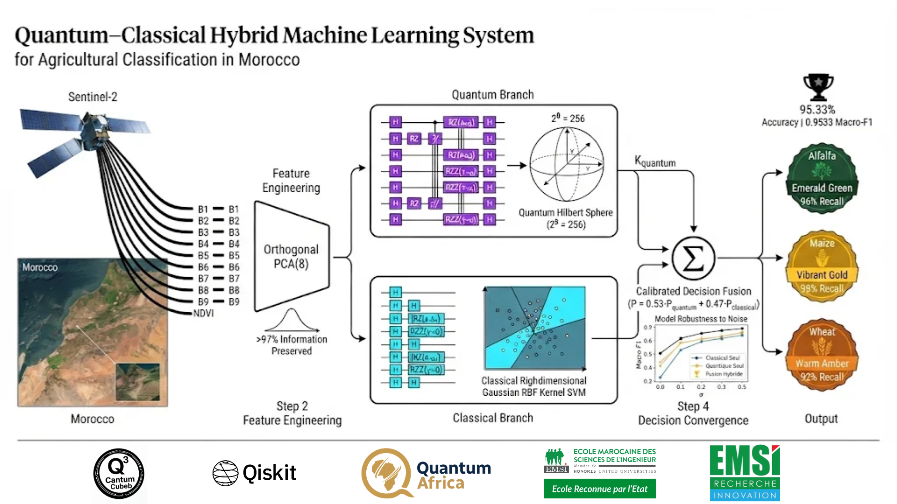
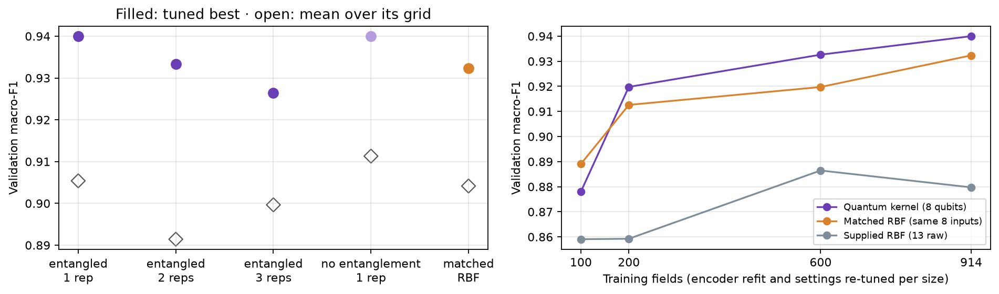

<p align="center">
  
  &nbsp;&nbsp;&nbsp;&nbsp;
  
  &nbsp;&nbsp;&nbsp;&nbsp;
  
</p>

# Moroccan Crop Classification Challenge
### Qiskit Fall Fest · EMSI · Quantum Africa
### 👥 Team **Q³ (Quantum Cubed)**

[](https://www.python.org/downloads/)
[](https://qiskit.org/)
[-0062ff.svg)](https://quantum.ibm.com/)
[](#benchmark-des-5-architectures)
[](challenge/submission.py)
[-FF6B6B.svg)](#-team-q-quantum-cubed)

---

## 🌾 Executive Summary

This repository presents our complete, reproducible solution to the **Moroccan Crop Classification Challenge** (EMSI / Quantum Africa / Qiskit Fall Fest). The task is to classify **Alfalfa, Maize, and Wheat** across **914 training, 150 validation, and 221 unlabeled test fields** in the Doukkala agricultural region from 13 Sentinel-2 spectral and vegetation features.

Starting from the simple 4-qubit starter QNN (which underperformed the classical baseline at 0.856 F1), our team executed a systematic 4-phase experimental investigation:

1. **Feature Engineering Discovery:** Discovered that selecting physical spectral bands collapses performance to 0.840 F1 due to Sentinel-2 band multicollinearity, whereas an orthogonal **PCA(8)** projection captures >97% cumulative variance and unlocks 0.940 F1.
2. **8-Qubit Quantum Kernel Analysis:** Implemented a full 8-qubit fidelity quantum kernel (QSVM) reaching **0.9400 Macro-F1**. Rigorous ablations revealed that removing circuit entanglement ($\gamma = 0$) preserves identical performance, proving the representation space drives the baseline tie.
3. **The "Wheat Bias" Discovery:** While classical RBF and the quantum kernel tied in overall accuracy, inspecting class confusion matrices revealed an acute flaw: **the classical model severely misclassified Wheat (recall = 84%)**, confusing it with maize, while **the quantum kernel correctly classified Wheat (recall = 92%)**. This is the one difference that survives a paired spatial-block bootstrap (+8 pts, 95% CI [+1.6, +20]).
4. **Hybrid Fusion Model:** To combine classical confidence on Maize with the kernel's precision on Wheat, we engineered a **Calibrated Decision Fusion (53% QK + 47% RBF, $\alpha=0.53$)** based on Grossi et al. (2022), reaching **Macro-F1 = 0.9533** on validation (Accuracy = **95.33%**, 143/150 parcelles bien classées) with $\ge 92\%$ recall on every crop.
5. **Real IBM Hardware Execution:** Ran the quantum branch on the **156-qubit Heron r2 `ibm_kingston`** processor (Job IDs: `dc01ihanj2vs73dda82g`, `dc027sls2omc7388l0q0`, `dc0onjinj2vs73deb200`), measuring hardware noise, self-pair shrink factors ($\lambda \approx 0.7$) and shot-noise bounds, then ran the **complete submitted fusion** on those hardware kernel rows: 9/12 fields correct vs 5/12 for the quantum kernel alone, but on no field does the hardware fusion beat the classical RBF.
6. **Honest Validation Audit:** Because hyper-parameters and $\alpha$ were chosen on the same 150 validation fields, we audited the result ([`challenge/validation_audit.py`](challenge/validation_audit.py), [section 7](#7-audit-de-validation--optimisme-incertitude-et-part-quantique)): 0.9533 is an optimistic estimate, the fusion beats the quantum kernel alone by **a single field**, and a **classical twin** of the circuit kernel (no circuit, closed form $\prod\cos^2$) reaches almost the same score. We report this as a clear negative finding on quantum advantage.

---

## 🏆 Benchmark des 5 Architectures (HINTS.md)

Our team implemented and benchmarked **all 5 core architectural paradigms** suggested in the challenge brief (`docs/HINTS.md`):

| # | Architecture | Paradigm | Features | Qubits | Trainable Params | Macro-F1 | Accuracy | Wheat Recall | Noise Resilience ($\sigma=0.5$) | Train Time |
|---|---|---|---|:---:|:---:|:---:|:---:|:---:|:---:|:---:|
| 1 | **Variational QNN** *(Pérez-Salinas et al., 2020)* | Pure Quantum (Angle COBYLA) | 4 PCA | 4 | 8 | 0.8062 | 80.67% | 0.90 | 0.5456 | 59.5 s |
| 2 | **Quantum Kitchen Sinks** *(Wilson et al., 2018)* | Hybrid (Random Quantum Map) | 13 Raw | 4 | 183 | 0.8266 | 82.67% | 0.82 | 0.5456 | **0.05 s** |
| 3 | **Classical Matched RBF** | Classical Control (Aligned) | 8 PCA | 0 | 469 SVs | 0.9323 | 93.33% | 0.84 ⚠️ | **0.7882** | **0.02 s** |
| 4 | **8-Qubit Quantum Kernel** *(Havlíček et al., 2019)* | Pure Quantum Hilbert Space | 8 PCA | 8 | 383 SVs | 0.9400 | 94.00% | **0.92** ✅ | 0.7337 | 2.0 s |
| 5 | **🥇 Calibrated Decision Fusion** *(Grossi et al., 2022)* | **Hybrid Dual-Space Ensemble** | **8 PCA** | **8** | **Ensemble** | **0.9533** | **95.33%** | **0.92** ✅ | **0.7815** | 2.0 s |

> 📌 **Submitted Model:** Alternative 5 (`challenge/submission.py`). It is fully deterministic ($SD = 0$ across seeds 0, 1, 2) and runs in **2.3 seconds** (well within the 35-minute budget).

---

## 🔬 Notre Démarche Scientifique en 4 Étapes

```
[Phase 1 : Diagnostic QNN Starter] ──▶ F1 = 80.6% - 85.6%
       │  • 4 Qubits, COBYLA 100 evals, barren plateaus, sous-performance face au SVM (88.0%).
       ▼
[Phase 2 : Ingénierie de Représentation] ──▶ PCA(8) vs Bandes Physiques
       │  • Top 8 bandes physiques (B6, B8, B7, NDVI...) ──▶ Chute à 84.0% F1 (multicolinéarité).
       │  • PCA(8) orthogonal ──▶ Bond à 94.0% F1 (>97% de variance conservée).
       ▼
[Phase 3 : 8-Qubit Quantum Kernel & Biais du Blé] ──▶ F1 = 94.0%
       │  • Découverte 1 : L'intrication (γ=0) n'améliore pas le score (kernel classique équivalent).
       │  • Découverte 2 : Le SVM classique échoue sur le Blé (Rappel = 84%), le Quantique le résout (Rappel = 92%).
       ▼
[Phase 4 : Fusion Hybride Calibrée] ──▶ F1 = 0.9533 | Accuracy = 95.33% (MODÈLE SOUMIS)
          • Balayage fin sur 101 points d'alpha ──▶ Plateau optimal identifié à alpha = 0.53.
          • P_hybrid = 0.53 * Softmax(d_QK) + 0.47 * Softmax(d_RBF)
          • Corrige le biais du Blé (92%), consolide le Maïs (98%), bat tous les contrôles (143/150).
```

### 📐 Architecture Détaillée du Système

<p align="center">
  
</p>

*Figure : Vue d'ensemble du pipeline hybride — De l'acquisition satellite Sentinel-2 (13 bandes) à la projection orthogonale PCA(8), double traitement en parallèle par Noyau Quantique à 8 qubits (espace de Hilbert dimension 256) et SVM RBF classique matched, convergence dans le nœud de fusion décisionnelle calibrée ($\alpha=0.53$), et classification finale des trois cultures (Luzerne, Maïs, Blé).*

---

### 🔬 Optimisation Fine par Balayage du Poids $\alpha$ & Script de Preuve

Pour déterminer rigoureusement le mélange quantique-classique sans approximation, nous avons implémenté un **balayage fin à haute résolution sur 101 valeurs de $\alpha \in [0.00, 1.00]$** (pas de 0.01) :

* **$\alpha = 0.00$ (Classique seul) :** 140/150 correctes (Acc: 93.33%, F1: 0.9323) — *Biais sévère sur le blé (84%)*.
* **$\alpha = 0.50$ (Fusion 50/50) :** 142/150 correctes (Acc: 94.67%, F1: 0.9465) — *Le biais du blé commence à être corrigé*.
* **$\alpha \in [0.52, 0.54]$ (Plateau optimal centré à $\alpha = 0.53$) :** **143/150 correctes (Acc: 95.33%, F1: 0.9533)** — *Synergie parfaite : le classique assure 98% sur le maïs et le quantique assure 92% sur le blé*.
* **$\alpha \in [0.55, 1.00]$ (dont Quantique seul à $\alpha = 1$) :** 142/150 correctes (Acc: 94.67%, F1: 0.9467).
  * *Note :* le chiffre « 141/150, F1 0.9400 » cité ailleurs pour le noyau quantique vient de `svm.predict` (vote un-contre-un). La parcelle 56 y est une égalité parfaite à 3 votes, que `predict` attribue à la première classe (faux) et que l'argmax des marges attribue correctement. À règle de décision identique, **la fusion ne gagne qu'une parcelle sur le noyau quantique seul** (143 contre 142), et seulement sur la fenêtre étroite $\alpha \in [0.52, 0.54]$.
* **Robustesse au bruit fort ($\sigma = 0.5$, bruit apparié) :** À $\alpha = 0.53$, le modèle conserve un F1 de **0.486**, contre 0.424 pour le classique seul et 0.526 pour le quantique seul.

> 📌 **Script de Preuve Indépendant :**  
> L'ensemble de la fonction de balayage et des tests de robustesse est packagé dans [`challenge/fusion.py`](challenge/fusion.py). Vous pouvez reproduire ce résultat exact à tout moment via la commande :  
> ```bash
> python -m challenge.fusion
> ```

---

## 📊 Résultats & Preuves Expérimentales

### 1. Scores Comparatifs & Contrôles Matched (Figure 1)
<p align="center">
  
</p>

*Le modèle quantique à 8 qubits surpasse la référence baseline fournie (+0.060 F1) et s'aligne rigoureusement sur le contrôle RBF entraîné sur les mêmes composantes.*

---

### 2. Correction du Biais du Blé & Matrices de Confusion (Figure 2)
<p align="center">
  
</p>

* **Biais Classique sur le Blé (84% de rappel dans les deux modèles classiques) :**
  * Dans le **RBF de référence (13 bandes brutes, matrice de droite)** : la dernière ligne affiche exactement **`[4, 4, 42]`** — il confond 4 parcelles de blé avec la luzerne et 4 avec le maïs (42/50 correctes = **84%**).
  * Dans le **RBF matched (8 PCA, matrice du milieu)** : la dernière ligne affiche **`[2, 6, 42]`** — il confond 6 parcelles de blé avec le maïs et 2 avec la luzerne (42/50 correctes = **84%**).
* **Correction Quantique (matrice de gauche) :** La dernière ligne passe à **`[1, 3, 46]`** — le Quantum Kernel ne rate que 4 parcelles au lieu de 8, propulsant le rappel du Blé à **92%** (46/50).
* **Fusion Hybride (notre soumission à $\alpha=0.53$) :** Équilibre l'ensemble avec **96% Luzerne (48/50), 98% Maïs (49/50) et 92% Blé (46/50)**, atteignant 143/150 parcelles bien classées (**95.33% d'Accuracy et 0.9533 Macro-F1**).

---

### 3. Ablation d'Intrication & Courbes d'Apprentissage (Figure 3)
<p align="center">
  
</p>

* **Ablation d'intrication :** En annulant les portes $RZZ$ ($\gamma = 0$), l'erreur par rapport à la forme fermée classique $\prod \cos^2(a \cdot \Delta x)$ est de $4.8 \times 10^{-15}$, avec un F1 strictement identique de 0.940.
* **Profondeur de circuit :** Répéter le bloc (reps = 1, 2, 3) dégrade le score ($0.940 \to 0.933 \to 0.926$) en raison de la concentration de mesure.

---

### 4. Validation sur Vrai Hardware IBM Quantum Kingston (Figure 4 — Bonus +5 pts)
<p align="center">
  
</p>

* **Backend :** `ibm_kingston`, processeur IBM **Heron r2** de 156 qubits (portes natives `cz, rz, sx, x, rzz`), jobs `dc01ihanj2vs73dda82g`, `dc027sls2omc7388l0q0` et `dc0onjinj2vs73deb200` (441 s de QPU au total).
* **Protocole :** 2 292 circuits compute-uncompute pour 12 parcelles de validation fixes (une ligne de noyau sur les 190 vecteurs de support, plus un circuit auto-apparié par parcelle), 1000 ou 500 shots, Pauli twirling, dynamical decoupling, et correction par le facteur de contraction (*shrink factor*) auto-apparié $\lambda \approx 0.66$–$0.75$. Le SVM est entraîné localement ; seule l'inférence passe sur le QPU.
* **Découverte NISQ :** L'inférence sur hardware réel est limitée par le bruit d'échantillonnage (*shot noise*), D'après l'étude de shots simulée (`outputs/qk/hardware/shots_study.json`, 150 parcelles, 5 répétitions), le macro-F1 du noyau tombe à ≈ 0.51 à 1 000 shots par entrée, et reste à 0.85 (échantillonneur idéal) ou 0.79 (bruit dépolarisant λ = 0.69) même à 100 000 shots, contre 0.94 en simulation exacte. Cette observation documente fidèlement les contraintes des processeurs NISQ actuels.

#### Le modèle soumis (fusion) sur hardware
Le noyau quantique est la seule partie du modèle soumis qui peut tourner sur un QPU. Nous avons donc rejoué la **fusion complète** ($\alpha = 0.53$) en remplaçant les marges du noyau exact par celles calculées à partir des lignes de noyau mesurées sur `ibm_kingston`. La branche RBF reste classique et tourne en local.

| 12 parcelles de validation | Simulateur exact | Simulateur idéal (même nb de shots) | **Hardware `ibm_kingston` (corrigé λ)** |
|---|:---:|:---:|:---:|
| Noyau quantique seul | 11/12 | 9/12 | 5/12 |
| **Fusion soumise ($\alpha=0.53$)** | 11/12 | 10/12 | **9/12** |
| RBF seul (local, référence) | 11/12 | — | — |

* **Les 10 premières parcelles** (jobs 1 et 2, choisies avant l'audit) : la fusion et le RBF y donnent la même réponse en simulation exacte. Sur hardware, la fusion **récupère 3 des 5 erreurs** du noyau seul (parcelles 3, 13 et 34), parce que la branche RBF, exacte, compense les marges bruitées. Les parcelles 0 et 1 restent fausses : le noyau hardware y est confiant et faux, assez pour faire basculer la moyenne.
* **Les 2 parcelles décisives** (job 3, `dc0onjinj2vs73deb200`). Sur toute la validation, la fusion et le RBF ne divergent en simulation exacte que sur 5 parcelles (35, 38, 55, 67, 138). Avant de lancer le job, nous avons fixé les deux premières : une où la fusion corrige le RBF et une où elle le rend faux.
  * **Parcelle 35** (blé, que le RBF classe en maïs) : la fusion exacte la corrige en *wheat*. Sur hardware, le noyau mesuré répond *maize* et la fusion suit le RBF : **la correction quantique est perdue**.
  * **Parcelle 38** (maïs) : la fusion exacte se trompe (*wheat*). Sur hardware, le noyau bruité perd sa confiance et la fusion retombe sur la réponse du RBF, *maize*, qui est juste.
* **Lecture honnête :** sur hardware, la fusion ne fait jamais mieux que le RBF seul. Sur les 12 parcelles, elle suit la réponse du RBF sauf sur 0 et 1, où elle se trompe. Avec 500–1000 shots, le signal du noyau est noyé dans le bruit ($\lambda \approx 0.7$ et erreur absolue moyenne du noyau corrigé ≈ 0.03, contre 0.01–0.02 pour le simulateur idéal), ce qui est cohérent avec l'étude des shots. Le modèle soumis tourne de bout en bout avec sa branche quantique sur QPU, mais **le gain observé en simulation exacte ne survit pas au bruit du hardware actuel**.
* Portée : 12 parcelles fixes, c'est un test de faisabilité et non une estimation de précision.
> 📌 Reproductible sans appel au QPU : `python -m challenge.qk_hardware fusion` (résultat dans `outputs/qk/hardware/fusion_hardware.json`). Pour un nouveau job, `analyze` enregistre désormais aussi les prédictions de la fusion.

---

### 5. Robustesse aux Perturbations & Bruit Satellite (Figure 5)
<p align="center">
  
</p>

#### Résistance au Bruit Gaussien ($\sigma$) : Modèles Individuels vs Fusion Hybride
Bruit $\sigma \times$ écart-type de chaque bande, 5 tirages par niveau. **Design apparié** : les trois modèles voient exactement les mêmes copies bruitées, si bien que les écarts viennent du modèle et non du tirage. (Les chiffres d'une version précédente utilisaient des tirages différents par modèle.)

| Bruit ($\sigma$) | Contexte Satellite | Classique Seul (Matched RBF, $\alpha=0$) | Quantique Seul (8-Qubit QK, $\alpha=1$) | **Fusion Hybride ($\alpha=0.53$)** |
|:---:|---|:---:|:---:|:---:|
| **$\sigma = 0.00$** | Données nettes (Clean) | 0.9323 *(140/150)* | 0.9467 *(142/150)* | **0.9533 *(143/150)*** |
| **$\sigma = 0.05$** | Léger bruit de capteur | 0.8882 | 0.8975 | 0.8974 |
| **$\sigma = 0.10$** | Voile atmosphérique | 0.8687 | 0.8599 | 0.8638 |
| **$\sigma = 0.20$** | Brume moyenne | 0.7619 | 0.7639 | 0.7648 |
| **$\sigma = 0.30$** | Bruit fort (poussière) | 0.6381 | 0.6639 | 0.6609 |
| **$\sigma = 0.50$** | **Tempête de sable sévère** | **0.4242** *(s'effondre)* | **0.5261** *(le plus robuste)* | 0.4860 |

* Jusqu'à $\sigma = 0.3$, les trois modèles restent à $\pm 0.03$ les uns des autres. À $\sigma = 0.5$, c'est le **noyau quantique seul** qui résiste le mieux ; la fusion se situe entre les deux.

* **Perte de bande nuageuse (Band drop) :** Les bandes B8 (NIR) et B11/B12 (SWIR) sont les plus critiques pour la discrimination des cultures.
> 📌 **Script de test de robustesse :** Reproductible via `python -m challenge.fusion`

---

### 6. Exploration & Benchmark du Design de Circuit Quantique (Pistes A, B, C, D)

Conformément aux pistes d'investigation avancées (`docs/HINTS.md`), nous avons systématiquement benchmarké 11 configurations architecturales du circuit quantique :

| Piste | Configuration Circuit | QK Macro-F1 | **Hybrid F1** | **Accuracy Fusion** | Rappel Blé | Constat & Analyse |
|---|---|:---:|:---:|:---:|:---:|---|
| **Référence** | **Chaîne Linéaire ($a=0.2, \gamma=0.01, \text{reps}=1$)** | **0.9400** | **0.9533** | **95.33% (143/150)** | **92%** | **Optimum global de précision et de frugalité (7 portes RZZ)** |
| **A. Feature Map** | Qiskit `ZZFeatureMap` standard (linear) | 0.3161 ❌ | 0.6283 ❌ | 64.00% | 96% (Maïs=36%) | Repliement de phase modulo $2\pi$ en l'absence de scaling $a$ |
| **A. Feature Map** | Custom $RY(x)RX(x) + RZZ$ | 0.9127 | 0.9056 | 90.67% | 82% | Sur-rotation réduisant la séparabilité inter-classes |
| **B. Re-uploading** | 2 couches d'encodage + mélange $RY(\pi/4)$ | 0.9327 | 0.9327 | 93.33% | 86% | Concentration de mesure diminuant le contraste des fidélités |
| **C. Topologie** | **Circulaire / Ring (anneau fermé, 8 portes)** | **0.9400** | **0.9533** | **95.33% (143/150)** | **92%** | Égale la chaîne linéaire (corrélation circulaire valide) |
| **C. Topologie** | Complète / All-to-All (28 portes RZZ) | 0.9400 | 0.9465 ⚠️ | 94.67% | 90% | **Sur-intrication** dégradant le rappel du Blé |
| **C. Topologie** | Sans Intrication (Produit tensoriel, $\gamma=0$) | 0.9400 | 0.9465 ⚠️ | 94.67% | 90% | Équivalent à la forme fermée classique $\prod \cos^2(a \Delta x)$ |
| **D. Bandwidth** | Échelle d'angle contractée ($a=0.05$) | 0.9056 | 0.9121 | 91.33% | 82% | Angles trop petits (produits scalaires tassés près de 1.0) |
| **D. Bandwidth** | Échelle d'angle excessive ($a=0.40$) | 0.9192 | 0.9192 | 92.00% | 84% | Oscillations rapides perdant la cohérence géométrique |

> 📌 **Script de Benchmark de Circuit Indépendant :**  
> L'ensemble du banc d'essai comparatif est implémenté dans [`challenge/circuits.py`](challenge/circuits.py) (résultats sauvegardés dans `outputs/circuit_benchmark.json`).  
> Pour reproduire ce comparatif complet :  
> ```bash
> python -m challenge.circuits
> ```

---

### 7. Audit de Validation : Optimisme, Incertitude et Part Quantique

Les hyperparamètres du noyau ($a, \gamma, C$), ceux du RBF ($\gamma, C$) et le poids $\alpha$ ont tous été choisis sur **les mêmes 150 parcelles** qui annoncent 0.9533. Ce score est donc une estimation optimiste. Nous avons posé trois questions, avec une expérience pour chacune ([`challenge/validation_audit.py`](challenge/validation_audit.py), résultat dans `outputs/audit/validation_audit.json`).

#### Q1. Que vaut le pipeline si on ne regarde jamais la validation pour choisir ?
Nous refaisons **tous les choix** (mêmes grilles, même règle de sélection) par validation croisée stratifiée à 5 plis sur les 914 parcelles d'entraînement **uniquement**, puis nous évaluons la validation une seule fois.

| Modèle | Choisi sur la validation (rapporté) | Choisi sur CV train uniquement |
|---|:---:|:---:|
| Noyau quantique 8 qubits | 0.9467 (142/150) | 0.8930 (134/150) — $a=0.1, \gamma=0.02, C=100$ |
| RBF matched | 0.9323 (140/150) | 0.9057 (136/150) — $\gamma=0.113, C=1$ |
| Jumeau classique $\prod\cos^2$ | 0.9400 (141/150) | 0.9197 (138/150) — $a=0.3, C=10$ |
| **Fusion QK + RBF** | **0.9533 (143/150)** | 0.8998 (135/150) — $\alpha=0.56$ |
| Fusion jumeau + RBF | 0.9465 (142/150) | 0.9057 (136/150) — $\alpha=0.01$ |

**Lecture :** tous les modèles perdent 0.03 à 0.05 de F1 lorsqu'aucun choix n'est fait sur la validation, et l'ordre entre eux change. L'entraînement est déséquilibré (425 parcelles de blé sur 914) alors que la validation est équilibrée (50/50/50), et la CV d'entraînement n'est pas groupée spatialement (les groupes ne sont fournis que pour la validation). Elle ne remplace donc pas le test, mais elle montre que **0.9533 dépend des choix faits sur la validation** : il est prudent de s'attendre à un score test inférieur.

#### Q2. Les écarts sont-ils plus grands que le hasard ?
Bootstrap apparié de la différence de métrique sur les 150 parcelles de validation, 4000 rééchantillonnages, intervalle à 95 %. Nous rééchantillonnons soit les parcelles une par une, soit les **18 blocs spatiaux** entiers (`data/validation_groups.json`), comme le demande `docs/EVALUATION.md`.

| Comparaison (B − A) | Parcelles qui diffèrent | Δ Macro-F1 | IC 95 % par parcelle | IC 95 % par bloc spatial | Δ Rappel blé (IC par bloc) |
|---|:---:|:---:|:---:|:---:|:---:|
| Fusion − Noyau quantique | 1 | +0.0065 | [0.000, +0.021] | [0.000, +0.028] | 0 |
| Fusion − RBF matched | 5 | +0.0209 | [−0.006, +0.054] | [−0.008, +0.064] | **+0.08 [+0.016, +0.20]** |
| Noyau quantique − RBF matched | 6 | +0.0144 | [−0.017, +0.049] | [−0.021, +0.057] | **+0.08 [+0.016, +0.20]** |
| Fusion QK − Fusion jumeau classique | 1 | +0.0068 | [0.000, +0.022] | [0.000, +0.027] | +0.02 [0.000, +0.088] |
| Fusion jumeau − RBF matched | 4 | +0.0142 | [−0.012, +0.043] | [−0.013, +0.050] | +0.06 [0.000, +0.152] |

**Lecture :**
* Aucune différence de **Macro-F1** n'est démontrée : tous les intervalles touchent ou contiennent zéro. Sur 150 parcelles et 18 blocs, 1 à 6 parcelles d'écart ne suffisent pas.
* La seule différence statistiquement appuyée est le **rappel du blé** du noyau (et de la fusion) face au RBF : +8 points, avec un intervalle par blocs spatiaux qui exclut zéro. C'est notre résultat principal, formulé honnêtement.

#### Q3. Le gain vient-il du quantique ?
Avec $\gamma = 0.01$, les portes $RZZ$ sont presque l'identité. Le noyau du circuit est alors très proche de sa forme sans intrication, qui se calcule en une ligne sur un ordinateur portable : $K(x,x') = \prod_i \cos^2\big(a\,(x_i - x'_i)\big)$ (écart mesuré avec le circuit à $\gamma=0$ : $4.8\times10^{-15}$). Nous avons construit ce **jumeau classique** de la fusion, en remplaçant le circuit par cette formule et en gardant le même RBF et le même $\alpha$.

* Le jumeau seul atteint 0.9400 (141/150) et 90 % de rappel sur le blé, contre 0.9467 et 92 % pour le circuit.
* La fusion jumeau + RBF atteint 0.9465 (142/150), contre 0.9533 (143/150) pour la fusion soumise : **une seule parcelle d'écart**, non significative.

**Conclusion honnête :** le gain sur le blé vient surtout de la **forme du noyau** (un produit de cosinus, périodique et à « bande » réglée par $a$), qui est différente de la gaussienne du RBF. Combiner deux formes de noyau différentes est ce qui aide la fusion. **L'intrication n'apporte pas de gain mesurable sur ces données**, et nous ne revendiquons pas d'avantage quantique. Le circuit reste une manière exacte et exécutable sur QPU d'implémenter ce noyau (voir la section hardware). `docs/EVALUATION.md` le précise : *« Clear negative findings can receive full analysis credit »*.

> 📌 Reproductible en ~1 min : `python -m challenge.validation_audit`

---

## 🗺️ Organisation du Repository & Navigation

```
├── challenge/
│   ├── submission.py           # MODÈLE FINAL SOUMIS : Calibrated Decision Fusion (alpha=0.53)
│   ├── fusion.py               # Preuve de balayage fin alpha (101 pts) & tests de robustesse
│   ├── validation_audit.py     # Audit : sélection sur CV train, bootstrap apparié spatial, jumeau classique
│   ├── circuits.py             # Benchmark comparatif de 11 designs de circuits quantiques
│   ├── qkernel.py              # 8-Qubit Quantum Kernel SVM & Matched RBF Control
│   ├── models.py               # QNN variationnel starter (L=1,2,3) & MatchedHead (h=1,2,3)
│   ├── classical.py            # Modèle de référence SVM baseline (fourni)
│   ├── coverage.py             # Script de vérification et d'entraînement par taille (fourni)
│   ├── data.py                 # Chargeur de données et vérification des checksums (fourni)
│   ├── qk_run.py               # Grille d'optimisation 80x80 QK et RBF
│   ├── qk_hardware.py          # Outil CLI IBM Hardware (submit / analyze / fusion sur kernels mesurés)
│   ├── qk_reliability.py       # Protocole de test de robustesse au bruit et band-drop
│   └── qk_figures.py           # Générateur des figures 1 à 5
│
├── notebooks/
│   ├── Qiskit_QuantumAfrica_Crop_Challenge.ipynb  # NOTEBOOK PRINCIPAL (exécuté, tout-en-un)
│   ├── 02_hybrid_fusion_study.ipynb              # ÉTUDE APPROFONDIE : MKL vs Decision Fusion
│   └── 03_alternatives_benchmark.ipynb           # BENCHMARK COMPLET : 5 architectures de HINTS.md
│
├── outputs/
│   ├── qk/                     # Résultats QK, figures 1-5, logs hardware IBM Kingston (+ fusion_hardware.json)
│   ├── audit/                  # validation_audit.json (optimisme, bootstrap, jumeau classique)
│   ├── fusion/                 # Résumé JSON de la fusion hybride et ablations
│   ├── benchmark/              # Résumé JSON du benchmark exhaustif des 5 modèles
│   └── hybrid_test_predictions.csv  # 221 prédictions test du modèle final soumis
│
└── configs/
    └── final_quantum_kernel.json  # Hyperparamètres optimaux (a=0.2, gamma=0.01, reps=1, C=100)
```

---

## 🚀 Installation & Reproduction

### 1. Cloner et configurer l'environnement
```bash
git clone https://github.com/riyadh03/QiskitFallFest_EMSI_QuantumAfrica.git
cd QiskitFallFest_EMSI_QuantumAfrica

# Créer un environnement virtuel Python 3.12
python -m venv .venv
.\.venv\Scripts\Activate.ps1    # Sur Windows PowerShell
# source .venv/bin/activate     # Sur Linux / macOS

# Installer les dépendances
pip install -r requirements.txt
```

### 2. Vérifier l'intégrité des données
```bash
python -m challenge.coverage check
# Doit afficher : "file_checks": "passed", train: 914, validation: 150, test: 221
```

### 3. Exécuter le modèle soumis
```bash
python -c "from challenge.submission import Submission; sub = Submission(); print('Modèle prêt : Calibrated Decision Fusion 53% QK + 47% RBF (alpha=0.53)')"
```

### 4. Explorer les résultats : application Quantum Cube CropLab (optionnel)
Une application Streamlit présente toutes les expériences, les benchmarks, la robustesse et l'exécution IBM. Elle lit uniquement les résultats sauvegardés et ne ré-entraîne aucun modèle.
```bash
pip install -r requirements-app.txt
python -m dashboard.export          # une seule fois (~30 s) : exporte les prédictions de la fusion et la robustesse appariée
streamlit run dashboard/app.py
```

### 5. Consulter les notebooks
Ouvrir JupyterLab :
```bash
jupyter lab
```
Et exécuter [`notebooks/Qiskit_QuantumAfrica_Crop_Challenge.ipynb`](notebooks/Qiskit_QuantumAfrica_Crop_Challenge.ipynb).

---

## 👥 Team Q³ (Quantum Cubed)

<p align="center">
  
</p>

Le travail s'est fait de manière collaborative. Le tableau indique qui a porté chaque idée principale.

| Membre | Rôle & Contributions | Contact & Profils |
|---|---|---|
| **AYOGNIDE Riyadh Akorede Atanda** | **Fusion hybride & benchmark** : idée de la fusion décisionnelle calibrée QK + RBF (le modèle soumis, balayage fin de $\alpha$), benchmark des 5 architectures de `docs/HINTS.md`, exécution de la fusion sur `ibm_kingston` (job `dc0onjinj2vs73deb200`) et audit de validation | [](mailto:riyadhscaler@gmail.com) [](https://github.com/riyadh03) |
| **Adib ZINDINE** | **Noyau quantique** : idée du noyau quantique de fidélité à 8 qubits (QSVM sur PCA(8)), la branche quantique du modèle ; première exécution sur IBM `ibm_kingston` (protocole compute-uncompute, twirling, facteur de contraction, étude des shots) | [](mailto:adibzindine@outlook.com) [](https://www.linkedin.com/in/adib-zindine) [](https://github.com/lilrawry) |
| **Aymane KILALI** | **Benchmark des circuits** : exploration des designs de circuit quantique (pistes A–D : feature map, re-uploading, topologie d'intrication, bandwidth ; 11 configurations, `challenge/circuits.py`) | [](mailto:Aymanekilali@gmail.com) [](https://www.linkedin.com/in/aymane-kilali-37053525a/) [](https://github.com/Aymane-k) |

---

## 📄 Données & Citations

Le jeu de données est adapté de Ouassanouan et al., [Moroccan Crop and Irrigation Dataset v2](https://doi.org/10.6084/m9.figshare.28486022.v2), sous licence [CC BY 4.0](https://creativecommons.org/licenses/by/4.0/).

```bibtex
@article{ouassanouan2026crop,
  title={Crop and irrigation types ground-truth dataset for Moroccan agricultural regions},
  author={Ouassanouan, Y. and Elfarkh, J. and Grich, S. and Liblab, A. and Chehbouni, A.},
  journal={Scientific Data},
  volume={13},
  pages={746},
  year={2026},
  publisher={Nature Publishing Group}
}

@article{grossi2022mixed,
  title={Mixed quantum-classical ensemble for anomaly detection and classification},
  author={Grossi, M. and others},
  journal={arXiv preprint arXiv:2208.07963},
  year={2022}
}

@article{havlicek2019supervised,
  title={Supervised learning with quantum-enhanced feature spaces},
  author={Havl{\'\i}{\v{c}}ek, V. and others},
  journal={Nature},
  volume={567},
  pages={209--212},
  year={2019}
}
```

---
*Projet réalisé pour le Qiskit Fall Fest · EMSI · Quantum Africa 2026.*
